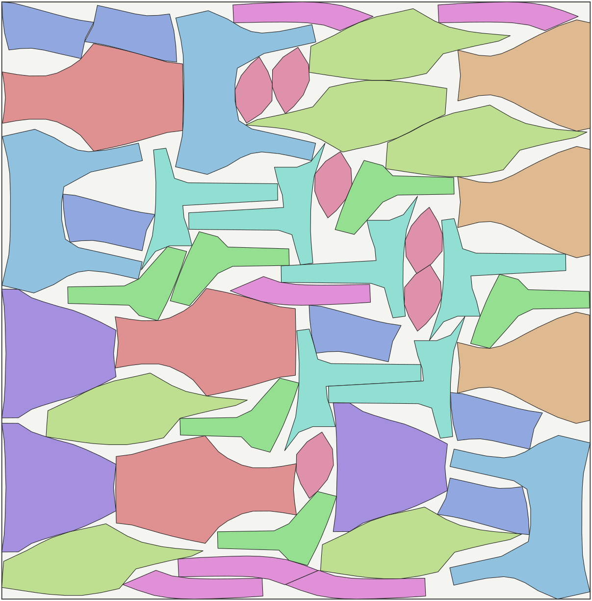
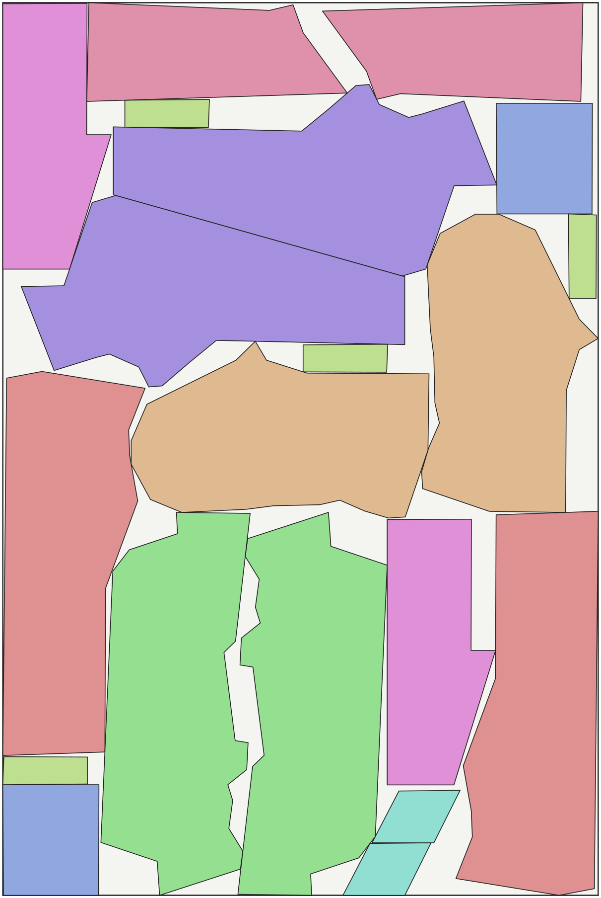

# kestrel - 2D irregular nesting and bin packing

[](https://github.com/Chen1098/2D-BinPaking/actions/workflows/ci.yml)

<p align="center">
  
  
</p>

**kestrel** packs arbitrary polygons - rectangles are just the easy case - into a strip of
minimum length or into as few bins as possible.  It is a from-scratch rewrite (Rust, no
geometry dependencies) of the toy solver this repository used to contain, built to compete
with the best published results.

> **Result in one paragraph.**  The reference is
> [sparrow](https://github.com/JeroenGar/sparrow) (Gardeyn, Vanden Berghe & Wauters,
> *European Journal of Operational Research* 2026), which improved on every earlier method
> on the classic benchmark of irregular strip packing.  Both solvers were run **side by side
> on the same machine**, under that paper's protocol (20 minutes, 3 threads), on its thirteen
> instances.  RESULT_HEADLINE
> Every layout of both solvers was checked by the same independent verifier in exact
> rational arithmetic.

[中文说明](README.zh-CN.md) · [How it works](docs/ALGORITHM.md) · [Benchmarks](#benchmarks) · [Limitations](#what-this-is-not)

## Quick start

```bash
cargo build --release

# strip packing: minimise the strip length (JSON instance, sparrow / jagua-rs format)
./target/release/kestrel solve -i data/strip/swim.json -t 60

# bin packing: the original plain-text format of this repo (board W H, then polygons)
./target/release/kestrel solve -i data/legacy/in.txt -t 30

# check any result with the independent verifier (plain Python, no packages)
python tools/verify.py data/strip/swim.json out/swim.json
```

Each run writes `out/<name>.json` (rotation and translation of every item) and
`out/<name>.svg` (a drawing of the layout), and prints one summary line:

```
RESULT name=swim bins=1 len=5596.689844 density=79.0411% feasible=true ...
```

Useful options (`kestrel` without arguments prints all of them):

| option | meaning |
|---|---|
| `-t <seconds>` | time limit (default 60) |
| `-w <threads>` | worker threads (default 3) |
| `-s <seed>` | random seed |
| `--evals <millions>` | deterministic budget instead of a time limit: same seed, same result, on any machine |
| `--rotations 0,90,180,270` | override the rotations allowed by the instance |
| `--mode strip\|bin`, `--bin-width <w>` | reinterpret an instance as strip / bin packing |
| `--min-sep <d>`, `--strict` | keep a minimum distance between items (`--strict`: 1e-6 of the item size, which makes the layout overlap free in exact arithmetic) |
| `--simplify <ratio>` | simplify very detailed outlines, only ever growing them |

### Input

* **JSON** (the format of [jagua-rs](https://github.com/JeroenGar/jagua-rs) / sparrow):
  `strip_height` for strip packing or `"bin": {"width": W, "height": H}` for bin packing, and
  a list of items with `demand`, allowed rotations and a simple polygon.  See
  [`data/README.md`](data/README.md).
* **Plain text** - the format of the original version of this repository: `W H`, the number
  of polygons, then for each polygon its vertex count and vertices.  It is solved as a bin
  packing problem (how many `W x H` boards are needed, and how short can the last one be).

## Benchmarks

### The protocol

* sparrow was built from source (commit `67bfaf8`, v0.3.0, `--features simd,only_final_svg`,
  `target-cpu=native`) and run with its default configuration.
* For every instance, sparrow and kestrel were started **at the same moment on the same
  laptop** (Intel Core Ultra 5 125H, Windows 11), each with 3 threads, the same time limit,
  the same seed number, the same priority, reading the same instance file.  Two such pairs
  ran at a time.  Whatever else the machine was doing therefore hit both solvers alike.
* kestrel ran with `--strict`, i.e. its items are strictly separated, like sparrow's.
* Afterwards **both** layouts were checked by [`tools/verify.py`](tools/verify.py), which
  shares no code with either solver and computes all pairwise intersection areas in exact
  rational arithmetic.  All layouts of both solvers passed with an overlap area of exactly
  zero, and the densities below are the ones recomputed by that checker.
* The whole procedure is one script:
  `python tools/paired_benchmark.py --sparrow <path to sparrow> --time 1200 --seeds 1`.

### 20 minutes (the protocol of the sparrow paper)

Density in %, higher is better.

RESULT_TABLE_20

"kestrel passes sparrow's final result after" is the moment in kestrel's run at which its
best layout became denser than the one sparrow ended with after 20 minutes.  The last three
columns are quoted from the sparrow paper: the expected density and the third quartile of 100
runs (on a faster desktop CPU, a Ryzen 9 7950X), and the best layout its authors ever
obtained.

RESULT_NOTES_20

<p align="center">
  
</p>

### 60 seconds

RESULT_TABLE_60

### Where the difference comes from

sparrow tests every candidate placement against the polygons around it.  kestrel precomputes,
for every pair of shapes, the exact region of relative positions in which they collide (the
no-fit polygon) together with a map of how bad the collision is, and then answers the same
question with one table lookup.  In the runs above it evaluated RESULT_SPEED as many
candidate placements per second as sparrow - on the same search scheme, which is sparrow's.
On top of that come moves that need the exact geometry: sliding all items into exact
contact, and squeezing a layout until it jams.  [docs/ALGORITHM.md](docs/ALGORITHM.md)
describes all of it, including a list of ideas that were tried and did not help.

The layouts and solution files of both solvers are in
[`results/strip_20min/`](results/strip_20min);
`python tools/verify.py data/strip/<name>.json results/strip_20min/kestrel/<name>.json`
(or `.../sparrow/<name>.json`) repeats the check.

<p align="center">
  
  
</p>
<p align="center">
  
  
  
</p>

## What this is not

* **Not a proof of optimality.**  It is a heuristic; the lower bounds for these instances are
  far below any known layout.
* **Statistics are thin.**  The paper reports 100 runs per instance; the tables above rest on
  RESULT_NSEEDS, because every pair of 20-minute runs costs 20 minutes of a laptop.  Single
  runs of this kind of search scatter by several tenths of a point (the paper reports
  interquartile ranges of 0.2-0.6), so differences of that size in one row mean little; the
  picture across the thirteen rows is what counts.
* **Tuned on the benchmark.**  The few parameters that are not sparrow's were chosen on these
  same instances.
* **The gap closes with time.**  RESULT_GAP
* **Discrete rotations only.**  Free rotation is approximated by a fixed number of angles;
  sparrow supports continuous rotation natively.
* **Memory grows with the square of the number of distinct oriented shapes** (one field per
  pair).  Instances with a few hundred distinct shapes are fine; thousands are not.
* **Simple polygons, rectangular containers.**  Holes inside items are ignored (treated as
  solid), containers with irregular outlines or defects are not supported.
* **Bin packing has no external comparison here.**  It is tested (perfect packings are
  found, the result is verified exactly), but it was not benchmarked against the bin packing
  literature.

## Repository layout

```
src/geom.rs       points, polygons, hulls, offsets, simplification
src/decomp.rs     convex decomposition (ear clipping + Hertel-Mehlhorn)
src/nfp.rs        exact no-fit-polygon fields
src/problem.rs    instances, oriented shapes, the field table
src/search.rs     placement search: sampling, coordinate descent, snap
src/separator.rs  guided local search, push relaxation
src/solve.rs      strip and bin packing drivers, compaction, squeeze
src/pool.rs       spin-waiting fork-join pool
tools/verify.py            independent exact checker (kestrel and sparrow solution files)
tools/paired_benchmark.py  the side-by-side benchmark against sparrow
tools/bench.py             deterministic A/B runs of kestrel settings
data/             benchmark instances
results/          the layouts behind the tables above
```

`cargo test --release` runs the unit and end-to-end tests; `kestrel selftest <instance>`
cross-checks the fields of an instance against an independent oracle.

## History

The first version of this repository (2023) wrapped every polygon in its bounding box and
scanned the board one unit at a time for a free spot; it is still in the git history.  On
its own test file (`data/legacy/in.txt`: 57 random convex polygons on a 700 x 700 board) its
boxes spread over the whole board (699 x 658).  kestrel packs the same polygons into the
first 432 units of the board's length in 30 seconds - 62 % of the board.

## References and credits

* J. Gardeyn, G. Vanden Berghe, T. Wauters, *An open-source heuristic to reboot 2D nesting
  research*, EJOR 2026 ([arXiv:2509.13329](https://arxiv.org/abs/2509.13329)).  kestrel's
  search loop (sampling moves, guided local search weights, exploration and compression
  phases) follows this paper, and its collision measure is the paper's overlap proxy,
  tabulated.  That sparrow is open source is what made a same-machine comparison possible at
  all.
* The benchmark instances are from [ESICUP](https://www.euro-online.org/websites/esicup/data-sets/),
  in the JSON conversion shipped with sparrow (MIT License).
* Further references are listed in [docs/ALGORITHM.md](docs/ALGORITHM.md).

MIT License.
