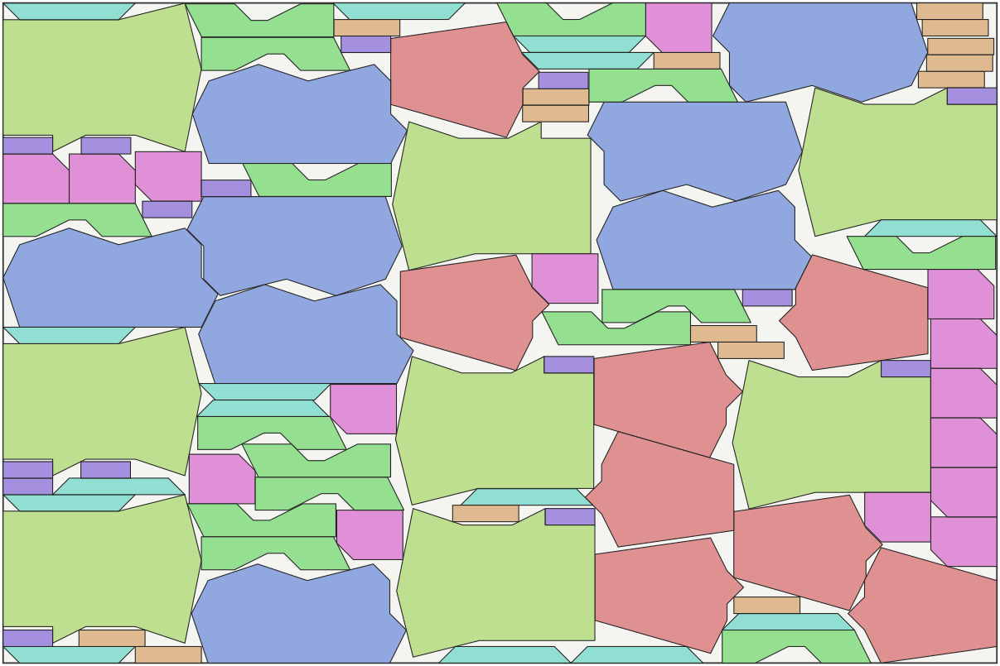
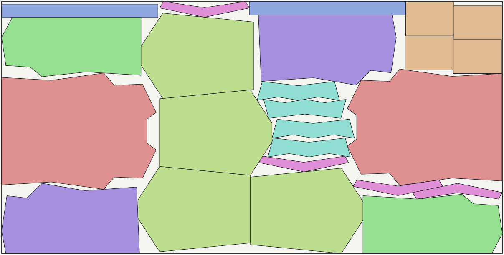
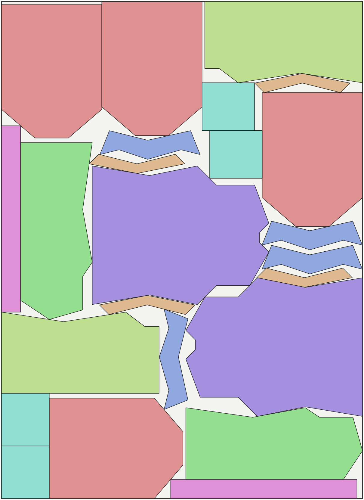

# kestrel - 2D irregular nesting and bin packing

<p align="center">
  
  
</p>

**kestrel** packs arbitrary polygons - rectangles are just the easy case - into a strip of
minimum length or into as few bins as possible.  It is a from-scratch rewrite (Rust, no
geometry dependencies) of the toy solver this repository used to contain, and it is built to
compete with the best published results.

> **Result in one sentence.**  On the thirteen classic benchmark instances of the irregular
> strip packing literature, under the protocol of the current state-of-the-art paper
> ([sparrow](https://github.com/JeroenGar/sparrow), Gardeyn, Vanden Berghe & Wauters,
> *European Journal of Operational Research* 2026: 20 minutes, 3 threads) and with both
> solvers running **side by side on the same machine**, kestrel produced the denser layout on
> **RESULT_WINS** instances, by **RESULT_MEAN** density points on average.  Every layout is
> verified overlap free in exact rational arithmetic by an independent checker.

[中文说明](README.zh-CN.md) · [How it works](docs/ALGORITHM.md) · [Benchmarks](#benchmarks) · [Limitations](#what-this-is-not)

## Quick start

```bash
cargo build --release

# strip packing: minimise the strip length (JSON instance, sparrow / jagua-rs format)
./target/release/kestrel solve -i data/strip/swim.json -t 60

# bin packing: the original plain-text format of this repo (board W H, then polygons)
./target/release/kestrel solve -i data/legacy/in.txt -t 30

# check any result with the independent verifier (plain Python, no packages)
python tools/verify.py data/strip/swim.json out/swim.json
```

Each run writes `out/<name>.json` (rotation and translation of every item) and
`out/<name>.svg` (a drawing of the layout), and prints one summary line:

```
RESULT name=swim bins=1 len=5596.689844 density=79.0411% feasible=true ...
```

Useful options (`kestrel` without arguments prints all of them):

| option | meaning |
|---|---|
| `-t <seconds>` | time limit (default 60) |
| `-w <threads>` | worker threads (default 3) |
| `-s <seed>` | random seed |
| `--evals <millions>` | deterministic budget instead of a time limit: same seed, same result, on any machine |
| `--rotations 0,90,180,270` | override the rotations allowed by the instance |
| `--mode strip\|bin`, `--bin-width <w>` | reinterpret an instance as strip / bin packing |
| `--min-sep <d>`, `--strict` | keep a minimum distance between items (`--strict`: 1e-6 of the item size, which makes the layout overlap free in exact arithmetic) |
| `--simplify <ratio>` | simplify very detailed outlines, only ever growing them |

### Input

* **JSON** (the format of [jagua-rs](https://github.com/JeroenGar/jagua-rs) / sparrow):
  `strip_height` for strip packing or `"bin": {"width": W, "height": H}` for bin packing, and
  a list of items with `demand`, allowed rotations and a simple polygon.  See
  [`data/README.md`](data/README.md).
* **Plain text** - the format of the original version of this repository: `W H`, the number
  of polygons, then for each polygon its vertex count and vertices.  It is solved as a bin
  packing problem (how many `W x H` boards are needed, and how short can the last one be).

## Benchmarks

### The protocol

The reference is *sparrow* (EJOR 2026), which the literature currently treats as the state of
the art: it improved on every earlier method on this benchmark (Elkeran 2013, Sato et al.
2019, ...), in the authors' words "in some cases by an unexpectedly wide margin".  Its
experiments give each run **20 minutes on 3 threads**.

Published numbers come from a different machine (and from 100 runs each), so the comparison
here was made directly:

* sparrow was built from source (commit `67bfaf8`, v0.3.0, `--features simd,only_final_svg`,
  `target-cpu=native`) and run with its default configuration;
* for every instance, sparrow and kestrel were started **at the same moment on the same
  laptop** (Intel Core Ultra 5 125H, Windows 11), each with 3 threads and a 1200 s limit, the
  same seed number, the same priority, reading the same instance file;
* kestrel ran with `--strict`, i.e. its items are strictly separated, like sparrow's;
* kestrel's layouts were re-checked by [`tools/verify.py`](tools/verify.py), which shares no
  code with the solver and computes all pairwise intersection areas in exact rational
  arithmetic.  The densities below are the ones recomputed by that checker.

The laptop was in normal use during the runs, which slows both solvers alike; kestrel
evaluated RESULT_SPEED as many candidate placements per second as sparrow in these runs.

### Results (density in %, higher is better)

RESULT_TABLE

The last four columns are quoted from the sparrow paper: its expected density and third
quartile over 100 runs (on a faster desktop CPU), the best layout its authors ever obtained,
and the best result of any earlier method.

RESULT_NOTES

The layouts and their solution files are in [`results/strip_20min/`](results/strip_20min);
`python tools/verify.py data/strip/<name>.json results/strip_20min/<name>.json` reproduces
the check.

<p align="center">
  
  
</p>
<p align="center">
  
  
  
</p>

### Where the difference comes from

Measured with deterministic budgets (150 million evaluated placements per run, SHIRTS / SWIM /
TROUSERS, 4 seeds each; `tools/bench.py` reproduces every line):

| variant | mean density |
|---|---|
| exact NFP fields, penetration-depth loss | 84.88 % |
| + overlap-proxy loss, evaluated per query (7x slower per evaluation) | 85.42 % |
| + the same proxy precomputed as a field (kestrel) | 85.52 % |

Together with a 5-6x higher evaluation rate than a collision engine that works on the
polygons directly, this is where the advantage comes from.  [docs/ALGORITHM.md](docs/ALGORITHM.md)
explains the design.

## What this is not

* **Not a proof of optimality.**  It is a heuristic; the lower bounds for these instances are
  far below any known layout.
* **Not a new record list.**  RESULT_RECORDS
* **Statistics are thin.**  The paper reports 100 runs per instance; the table above rests on
  RESULT_NSEEDS per instance and solver, because every pair of runs costs 20 minutes of a
  laptop.  The margins are large compared with the run-to-run spread the paper reports
  (interquartile ranges of 0.2-0.6 points), but single runs are single runs.
* **Discrete rotations only.**  Free rotation is approximated by a fixed number of angles;
  sparrow supports continuous rotation natively.
* **Memory grows with the square of the number of distinct oriented shapes** (one field per
  pair).  Instances with a few hundred distinct shapes are fine; thousands are not.
* **Simple polygons, rectangular containers.**  Holes inside items are ignored (treated as
  solid), containers with irregular outlines or defects are not supported.

## Repository layout

```
src/geom.rs       points, polygons, hulls, offsets, simplification
src/decomp.rs     convex decomposition (ear clipping + Hertel-Mehlhorn)
src/nfp.rs        exact no-fit-polygon fields
src/problem.rs    instances, oriented shapes, the lazily built field table
src/search.rs     placement search: sampling, coordinate descent, snap
src/separator.rs  guided local search, push relaxation
src/solve.rs      strip and bin packing drivers, compaction, squeeze
src/pool.rs       spin-waiting fork-join pool
tools/verify.py   independent exact checker
tools/bench.py    benchmark harness
data/             benchmark instances
results/          layouts behind the tables above
```

`cargo test --release` runs the unit and end-to-end tests; `kestrel selftest <instance>`
cross-checks the fields of an instance against an independent oracle.

## History

The first version of this repository (2023) wrapped every polygon in its bounding box and
scanned the board one unit at a time for a free spot.  It is still in the git history.  On
its own test file (`data/legacy/in.txt`: 57 random convex polygons on a 700 x 700 board) it
needed the whole board; kestrel packs the same polygons into the left RESULT_LEGACY of it.

## References and credits

* J. Gardeyn, G. Vanden Berghe, T. Wauters, *An open-source heuristic to reboot 2D nesting
  research*, EJOR 2026 ([arXiv:2509.13329](https://arxiv.org/abs/2509.13329)).  kestrel's
  search loop (sampling moves, guided local search weights, exploration and compression
  phases) follows this paper, and its collision measure is the paper's overlap proxy,
  precomputed.  Releasing sparrow as open source is what made a same-machine comparison
  possible at all.
* The benchmark instances are from [ESICUP](https://www.euro-online.org/websites/esicup/data-sets/),
  in the JSON conversion shipped with sparrow (MIT License).
* Further references are listed in [docs/ALGORITHM.md](docs/ALGORITHM.md).

MIT License.
