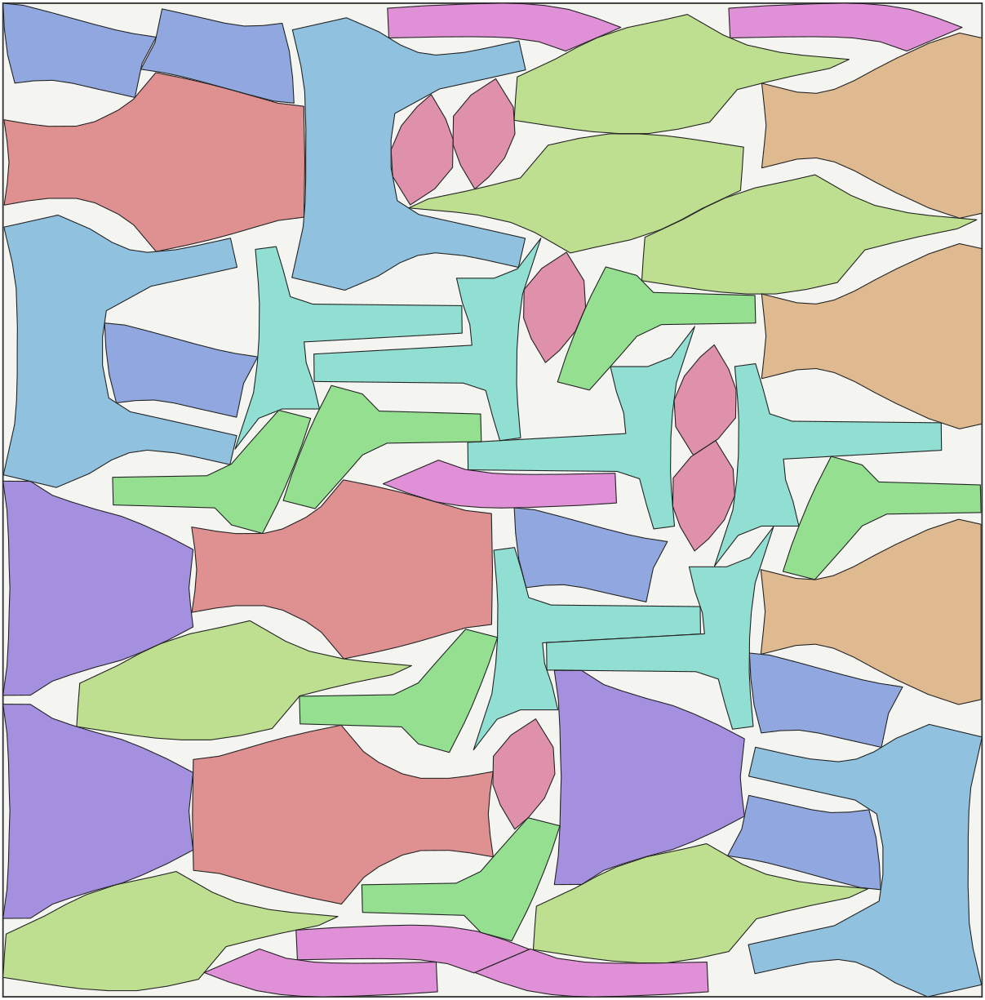
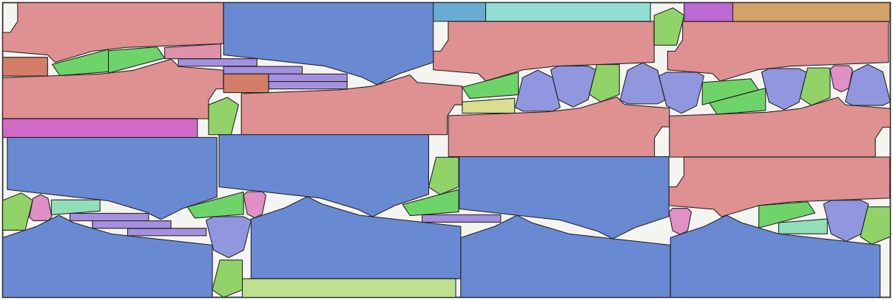
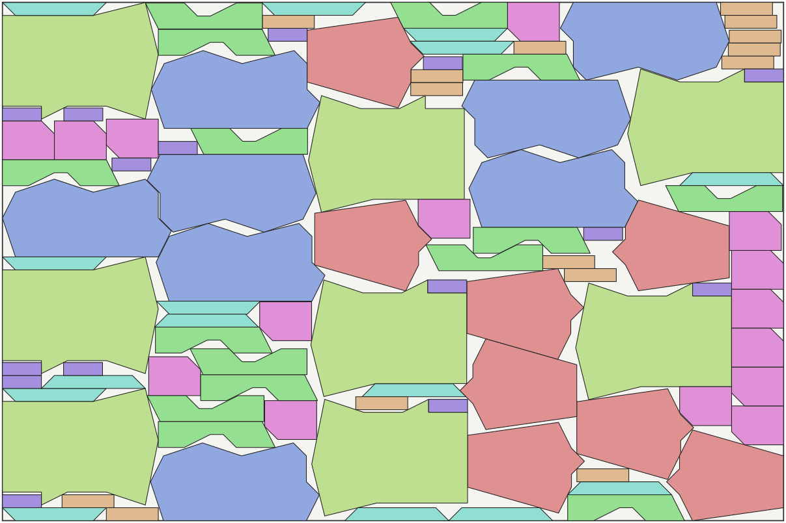
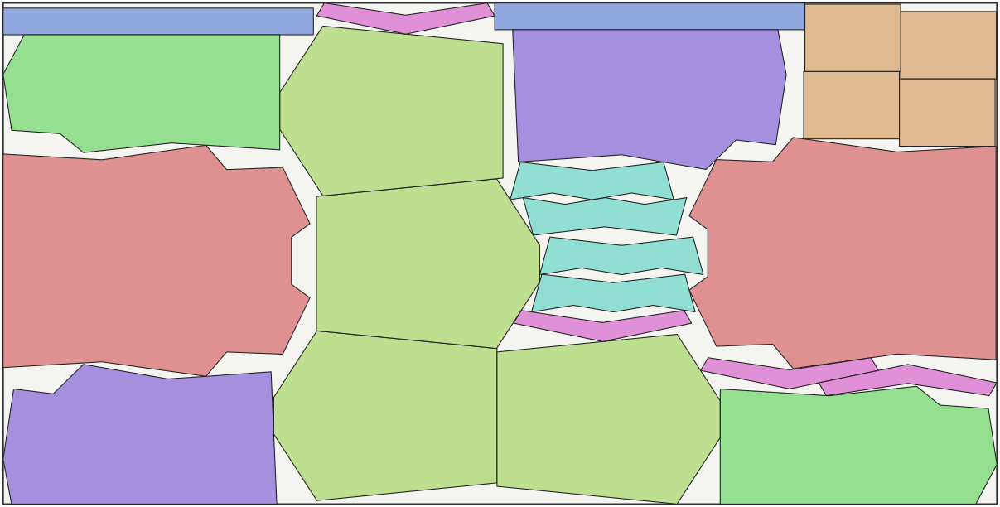
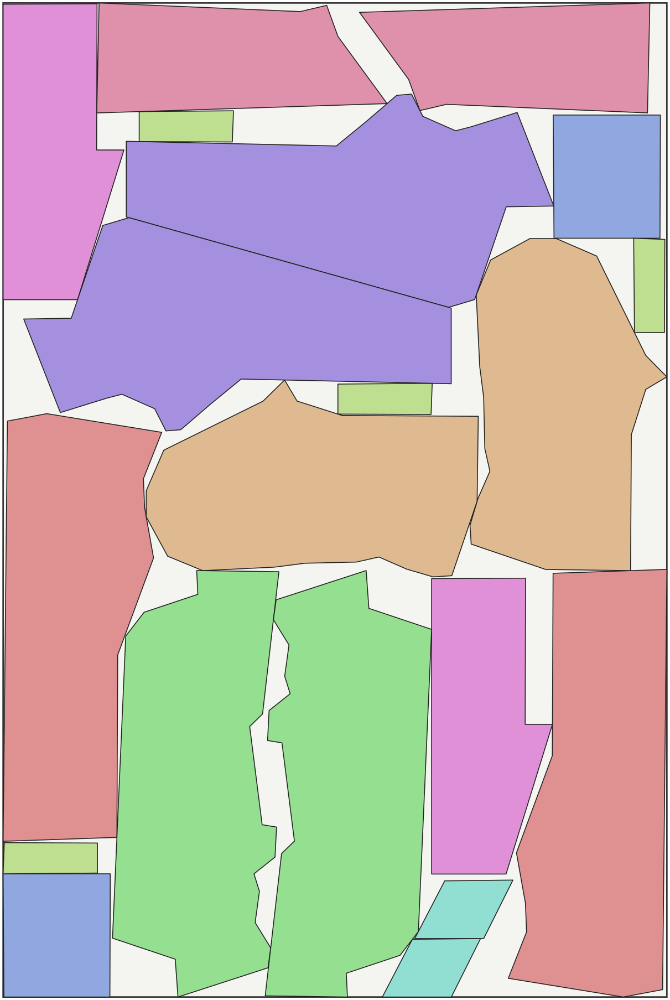
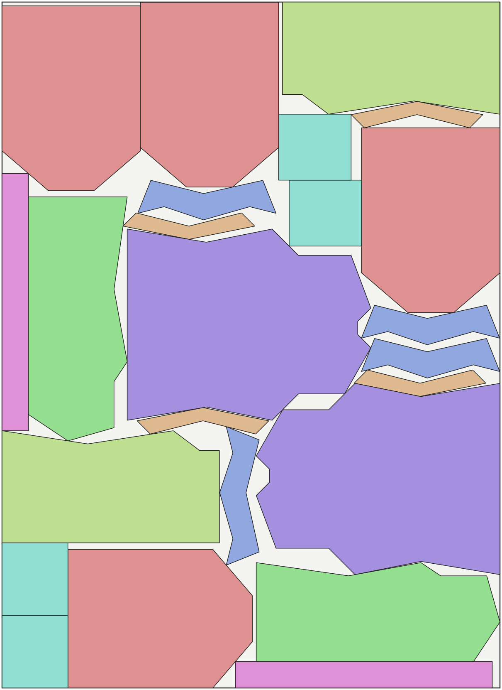
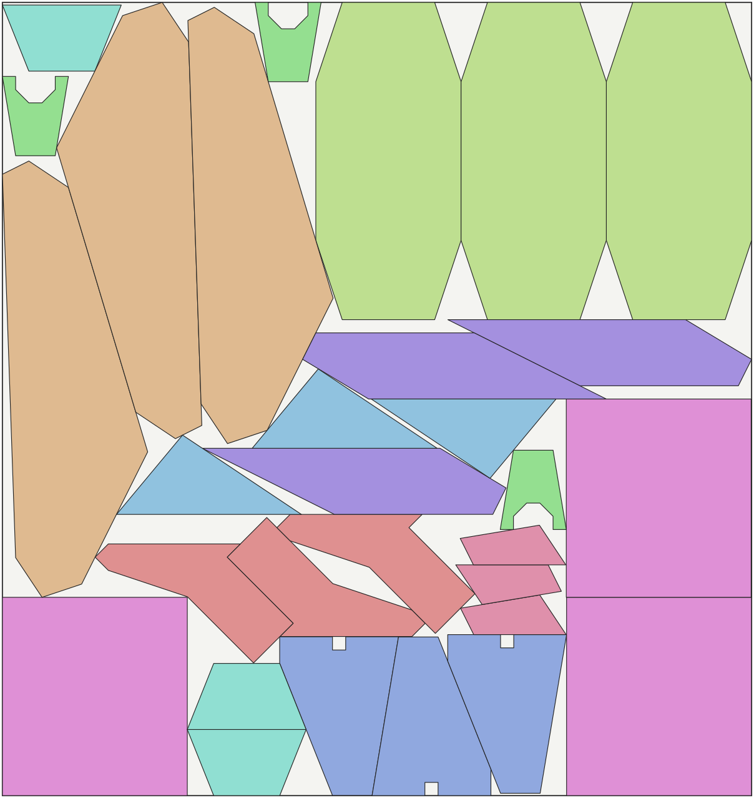

# kestrel —— 二维不规则排样 / 装箱求解器

<p align="center">
  
  
</p>

**kestrel** 把任意多边形（矩形只是最简单的特例）排进一条定高的条带并让长度最短，或者装进尽可能少的
固定尺寸板材。它是对本仓库原有“玩具级”解法的完全重写（Rust，无几何库依赖），目标是和已发表的最好
结果正面比较。

> **一句话结论。** 在不规则条带排样文献通用的 13 个经典基准实例上，按照当前最强论文
> （[sparrow](https://github.com/JeroenGar/sparrow)，Gardeyn、Vanden Berghe、Wauters，
> *European Journal of Operational Research* 2026）的实验协议（每次 20 分钟、3 线程），让两个求解器
> **在同一台机器上同时运行**，kestrel 在 **RESULT_WINS** 个实例上得到更密的排样，平均高出
> **RESULT_MEAN** 个百分点。所有排样结果都由一个独立的校验程序用精确有理数运算确认无重叠。

[English](README.md) · [算法原理](docs/ALGORITHM.md) · [基准测试](#基准测试) · [局限](#它不是什么)

## 快速上手

```bash
cargo build --release

# 条带排样：最小化条带长度（JSON 实例，sparrow / jagua-rs 格式）
./target/release/kestrel solve -i data/strip/swim.json -t 60

# 装箱：本仓库最初的纯文本格式（板材 W H，然后是各个多边形）
./target/release/kestrel solve -i data/legacy/in.txt -t 30

# 用独立校验器检查任意结果（纯 Python，无第三方依赖）
python tools/verify.py data/strip/swim.json out/swim.json
```

每次运行输出 `out/<name>.json`（每个零件的旋转角和平移量）和 `out/<name>.svg`（排样图），并打印一行摘要：

```
RESULT name=swim bins=1 len=5596.689844 density=79.0411% feasible=true ...
```

常用选项（不带参数运行 `kestrel` 可看到全部）：

| 选项 | 含义 |
|---|---|
| `-t <秒>` | 时间限制（默认 60） |
| `-w <线程数>` | 工作线程（默认 3） |
| `-s <种子>` | 随机种子 |
| `--evals <百万次>` | 用确定性的“评估次数预算”代替时间限制：同种子同结果，与机器快慢无关 |
| `--rotations 0,90,180,270` | 覆盖实例里允许的旋转角 |
| `--mode strip\|bin`、`--bin-width <w>` | 把实例当作条带 / 装箱问题来解 |
| `--min-sep <d>`、`--strict` | 零件间保持最小间距（`--strict`：零件尺寸的 1e-6，使结果在精确运算下严格无重叠） |
| `--simplify <比例>` | 简化顶点极多的轮廓（只会把轮廓变大，不会变小） |

### 输入格式

* **JSON**（[jagua-rs](https://github.com/JeroenGar/jagua-rs) / sparrow 的格式）：条带排样用
  `strip_height`，装箱用 `"bin": {"width": W, "height": H}`；`items` 里每个零件有数量 `demand`、
  允许的旋转角和一个简单多边形。详见 [`data/README.md`](data/README.md)。
* **纯文本**——本仓库最初版本的格式：`W H`、多边形个数，然后每个多边形先给顶点数再给各顶点。
  它按装箱问题求解（需要几块 `W x H` 的板，最后一块能排多短）。

## 基准测试

### 测试协议

对照对象是 *sparrow*（EJOR 2026）。它是目前文献公认的最强方法：在这套基准上全面超过了之前所有方法
（Elkeran 2013、Sato 等 2019……），原文的说法是“有些实例上的领先幅度出乎意料地大”。它的实验设置是
**每次运行 20 分钟、3 线程**。

论文里的数字来自另一台机器（而且每个实例跑了 100 次），所以这里直接做同机对比：

* sparrow 从源码编译（提交 `67bfaf8`，v0.3.0，`--features simd,only_final_svg`，
  `target-cpu=native`），使用它的默认配置；
* 对每个实例，sparrow 和 kestrel **在同一台笔记本上同一时刻启动**（Intel Core Ultra 5 125H，
  Windows 11），各用 3 线程、限时 1200 秒，种子编号相同、进程优先级相同、读取同一个实例文件；
* kestrel 使用 `--strict`，即零件之间严格分离，与 sparrow 的可行性标准一致；
* kestrel 的结果再用 [`tools/verify.py`](tools/verify.py) 复核：它与求解器不共享任何代码，
  用精确有理数运算计算所有零件两两之间的相交面积。下表的密度就是这个校验器重新算出来的。

测试期间这台笔记本还在正常使用，这会同等地拖慢两个求解器；在这些运行里，kestrel 每秒评估的候选
位置数是 sparrow 的 RESULT_SPEED。

### 结果（密度 %，越高越好）

RESULT_TABLE

最后四列引自 sparrow 论文：它 100 次运行的期望密度和上四分位数（在更快的台式机 CPU 上）、作者得到过的
最好排样，以及更早方法的最好结果。

RESULT_NOTES

排样图和解文件在 [`results/strip_20min/`](results/strip_20min)；运行
`python tools/verify.py data/strip/<name>.json results/strip_20min/<name>.json` 可复现校验。

<p align="center">
  
  
</p>
<p align="center">
  
  
  
</p>

### 优势从哪里来

用确定性预算测得（每次运行 1.5 亿次位置评估，SHIRTS / SWIM / TROUSERS 各 4 个种子；
`tools/bench.py` 可以复现每一行）：

| 变体 | 平均密度 |
|---|---|
| 精确 NFP 场 + 穿透深度损失 | 84.88 % |
| + 重叠代理损失，每次查询现算（单次评估慢 7 倍） | 85.42 % |
| + 把同一个代理预计算成场（kestrel 的做法） | 85.52 % |

再加上比“直接在多边形上做碰撞检测”的引擎高 5–6 倍的评估速度，这就是领先的来源。
设计细节见 [docs/ALGORITHM.md](docs/ALGORITHM.md)。

## 它不是什么

* **不是最优性证明。** 这是启发式算法；这些实例的理论下界远低于任何已知排样。
* **不是新的纪录表。** RESULT_RECORDS_ZH
* **统计样本很少。** 论文每个实例跑 100 次；上表每个实例、每个求解器只有 RESULT_NSEEDS_ZH，
  因为每一对运行要占用笔记本 20 分钟。领先幅度相对论文报告的运行间波动（四分位距 0.2–0.6 个点）
  是大的，但单次运行终究是单次运行。
* **只支持离散旋转。** 任意角度旋转用固定的若干角度近似；sparrow 原生支持连续旋转。
* **内存随“不同朝向形状数”的平方增长**（每一对形状一个场）。几百种不同形状没问题，几千种不行。
* **只支持简单多边形和矩形容器。** 零件内部的孔被忽略（当作实心），不支持不规则外形或带缺陷的板材。

## 仓库结构

```
src/geom.rs       点、多边形、凸包、偏移、轮廓简化
src/decomp.rs     凸分解（耳切法 + Hertel-Mehlhorn 合并）
src/nfp.rs        精确 NFP（临界多边形）场
src/problem.rs    实例、带朝向的形状、惰性构建的场表
src/search.rs     位置搜索：采样、坐标下降、精确吸附
src/separator.rs  引导式局部搜索、推挤松弛
src/solve.rs      条带 / 装箱主流程、压实、挤压
src/pool.rs       自旋等待的并行池
tools/verify.py   独立的精确校验器
tools/bench.py    基准测试脚本
data/             基准实例
results/          上表对应的排样结果
```

`cargo test --release` 运行单元测试和端到端测试；`kestrel selftest <实例>` 用独立判定方法交叉检查
该实例的所有 NFP 场。

## 历史

本仓库的第一个版本（2023 年）把每个多边形用外接矩形包起来，然后在板上一格一格地扫描找空位，它仍然
保留在 git 历史里。在它自带的测试文件上（`data/legacy/in.txt`：700 x 700 的板、57 个随机凸多边形），
它把外接矩形铺满了几乎整块板；kestrel 把同样的多边形排进了板左侧 RESULT_LEGACY 的范围。

## 参考与致谢

* J. Gardeyn, G. Vanden Berghe, T. Wauters, *An open-source heuristic to reboot 2D nesting
  research*, EJOR 2026（[arXiv:2509.13329](https://arxiv.org/abs/2509.13329)）。kestrel 的搜索主循环
  （采样移动、引导式局部搜索的权重、探索与压缩两个阶段）沿用了这篇论文，碰撞度量也是论文里的重叠代理，
  只是改成了预计算。正因为 sparrow 开源，同机对比才成为可能。
* 基准实例来自 [ESICUP](https://www.euro-online.org/websites/esicup/data-sets/)，使用 sparrow 仓库
  附带的 JSON 版本（MIT 许可）。
* 其余参考文献见 [docs/ALGORITHM.md](docs/ALGORITHM.md)。

MIT 许可。
